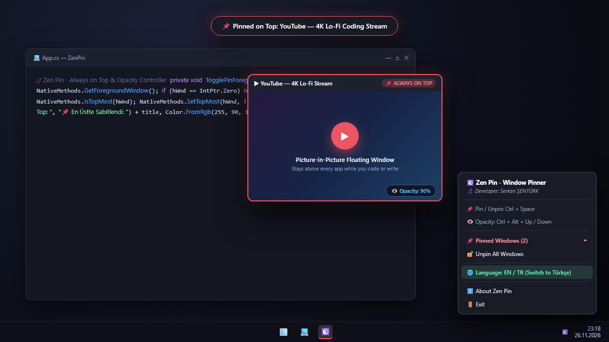

<div align="center">

# 📌 Zen Pin

**Always-on-Top Window Pinner, Opacity Controller & Picture-in-Picture Tool for Windows**

[](https://github.com/836982756578/Zen-Pin)
[](https://github.com/836982756578/Zen-Pin/releases/latest)
[](#key-features)
[](LICENSE)
[](https://github.com/836982756578/Zen-Pin/releases/latest)

<br />



</div>

---

## Overview

**Zen Pin** is a featherweight (~1 MB RAM), zero-install Windows utility that lets you pin any window on top of all others (**Always on Top**) and adjust its transparency on the fly — turning video players, calculators, terminals, or reference docs into effortless floating Picture-in-Picture windows.

## Key Features

| Feature | Description |
| :--- | :--- |
| 📌 **One-Shortcut Window Pinning** | Press `Ctrl + Space` on any active window to lock or unlock it above all other windows. |
| 👁️ **Live Transparency Control** | Press `Ctrl + Alt + Down` / `Ctrl + Alt + Up` to smoothly adjust any window's opacity from 20% to 100%. |
| 🔔 **Modern Animated HUD Pill** | Displays a sleek, non-intrusive on-screen pill notification whenever you pin, unpin, or change opacity. |
| 📋 **System Tray Window Manager** | Right-click the **☯️** tray icon to see all currently pinned windows and unpin individually or all at once. |
| 🌐 **English & Turkish (EN / TR)** | Built-in bilingual UI and HUD notifications with instant one-click language switching in the tray menu. |
| 🪶 **Ultra-Lightweight Portable** | Pure standalone `.exe` (~1–2 MB RAM) that cleanly restores all pinned states and opacities on exit. |

## Keyboard Shortcuts

| Shortcut | Action |
| :--- | :--- |
| **`Ctrl + Space`** | Pin / unpin the active window on top |
| **`Ctrl + Alt + Down Arrow`** | Decrease opacity (make window more transparent) |
| **`Ctrl + Alt + Up Arrow`** | Increase opacity (restore solid appearance) |

## Installation & Usage

1. Download the latest portable **`ZenPin.exe`** from the [Latest Release](https://github.com/836982756578/Zen-Pin/releases/latest) page.
2. Double-click `ZenPin.exe` — it starts silently in the system tray (**☯️**).
3. Focus any window and press **`Ctrl + Space`** to keep it on top!
4. Right-click the tray icon anytime to manage pinned windows or toggle **🌐 Language: EN / TR**.

## Build from Source

Requires Windows 10/11 with the built-in .NET Framework 4.x C# compiler (`csc.exe`):

```powershell
git clone https://github.com/836982756578/Zen-Pin.git
cd Zen-Pin
.\build.ps1
```

## License

This project is licensed under the [MIT License](LICENSE).  
Copyright © 2026 [Serkan ŞENTÜRK](https://github.com/836982756578).
